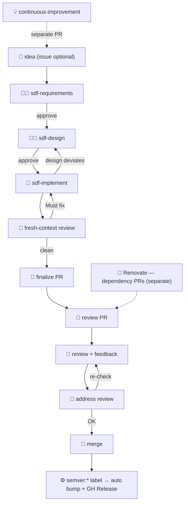

# AI-led development workflow

AI drives implementation; humans focus on quality assurance and final decisions.

## Flow

1. **Human**: Start from an idea (optionally a GitHub Issue as an inbox), then ask Claude to run `sdf-requirements`
2. **Human/AI**: Co-write requirements, then design, in a session; the human approves each (`sdf` rule)
3. **AI**: Implement slice by slice, then review in a fresh context against the requirements, the design, and `coding-guide`
4. **AI**: Finalize the Draft PR (`create-pull-request`); review it when ready (`review-pull-request`, `.github/workflows/claude-review.yml`)
5. **Human**: Review behavior, Storybook, etc., and leave feedback
6. **AI**: Address review feedback on request (`address-pr-review`)
7. **Human**: Re-check and merge

- Do not start the next phase until the owner approves the current one. Do not implement before the design is `agreed`.
- Do not change beyond the agreed requirements and design.
- Phases, documents, and branch handling: `sdf` rule. Layout: `project-structure` skill. Conventions and design principles (including module depth): `coding-guide` skill. Language: English.
- Every PR to `main` must carry exactly one `semver:major` / `semver:minor` / `semver:patch` label (CI). On merge, Actions bumps `package.json` and publishes the GitHub Release. `renovate[bot]` defaults to patch.

## Release cycle

**Automated.** Feature/fix/chore PRs declare their semver impact with a label; merging to `main`
is the release. Do not open a dedicated release PR for routine bumps. Distinct from Renovate's
dependency-update PRs (same review path; patch bump by default).

## Subagents

Delegate routine work via the Agent tool. Pass only what the subagent needs.

Delegate only when a step is part of this flow **and** its journey needn't be watched—delegation
just trims context.

| When | Subagent |
|------|----------|
| Review in `sdf-implement` | a fresh-context reviewer (per `sdf-implement`) |
| PR opened / review requested | `review-pull-request` |
| Review feedback | `address-pr-review` |

## Triggers

Mention `@claude` on an issue, PR, or PR review (`.github/workflows/claude.yml`). **Only the repository owner can trigger it**; others' mentions are ignored. The one exception is the automatic review on PR open (`claude-review.yml`, same-repo non-draft PRs, read-only). The mention is the decision to proceed, so write the intent explicitly.

| Comment | Step |
|---------|------|
| `@claude implement` on a Draft PR | Run `sdf-implement` from the agreed `design.md` |
| `@claude review` on a PR | `review-pull-request` again (the first review runs automatically when the PR opens) |
| `@claude address` on a PR or review | `address-pr-review` |

Manual runs in Claude Code (e.g. "implement the 20261030-foo spec") work the same way.
