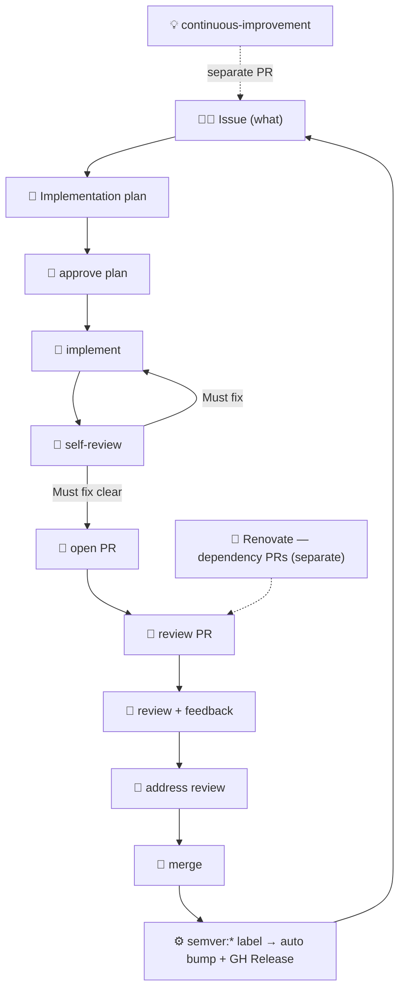

# AI-led development workflow

AI drives implementation; humans focus on quality assurance and final decisions.

## Flow

1. **Human/AI**: Open a request as a GitHub Issue (what — background, requirements, acceptance criteria)
2. **AI**: Read the issue with `gh issue view` and propose an implementation plan
3. **Human**: Review the plan and approve on the issue (comment or label)
4. **AI**: Implement per the approved plan, pass tests
5. **AI**: Loop `self-review` → fix **Must fix** → re-review until Must fix is clear; optionally fix other notes; then open a PR
6. **AI**: Review the PR on request (`review-pull-request`)
7. **Human**: Review behavior, Storybook, etc., and leave feedback
8. **AI**: Address review feedback on request (`address-pr-review`)
9. **Human**: Re-check and merge

- Do not implement before the plan is approved (approval on the issue).
- Do not change beyond the approved scope.
- Implementation steps: `implement-issue` skill. Layout: `project-structure` skill. Language: English.
- Make it work during implementation; **module depth and design are audited in the `self-review` loop before the PR**, not mid-feature. Do not open a PR while **Must fix** remains. Other self-review notes are optional: fix if useful, or document “not necessary” under Impact and risks.
- Every PR to `main` must carry exactly one `semver:major` / `semver:minor` / `semver:patch` label (CI). On merge, Actions bumps `package.json` and publishes the GitHub Release. `renovate[bot]` defaults to patch.

## Release cycle

**Automated.** Feature/fix/chore PRs declare their semver impact with a label; merging to `main`
is the release. Do not open a dedicated release PR for routine bumps. Distinct from Renovate's
dependency-update PRs (same review path; patch bump by default).

## Subagents

Delegate routine work via the Agent tool. Pass only what the subagent needs.

Delegate only when a step is part of this flow **and** its journey needn't be watched—delegation
just trims context.

| When | Subagent |
|------|----------|
| Create issue | `create-github-issue` |
| Implement | `implement-issue` |
| Before PR | `self-review` |
| Open PR | `create-pull-request` |
| Review requested | `review-pull-request` |
| Review feedback | `address-pr-review` |

## Triggers

Mention `@claude` on an issue, PR, or PR review (`.github/workflows/claude.yml`). **Only the repository owner can trigger it**; others' mentions are ignored. The mention is the approval, so write the intent explicitly.

| Comment | Step |
|---------|------|
| `@claude plan` on an issue | Propose a plan; do not implement |
| `@claude implement` on an issue | Implement the approved plan through PR (`implement-issue`) |
| `@claude review` on a PR | `review-pull-request` |
| `@claude address` on a PR or review | `address-pr-review` |

Manual runs in Claude Code (e.g. "implement #123") work the same way.
