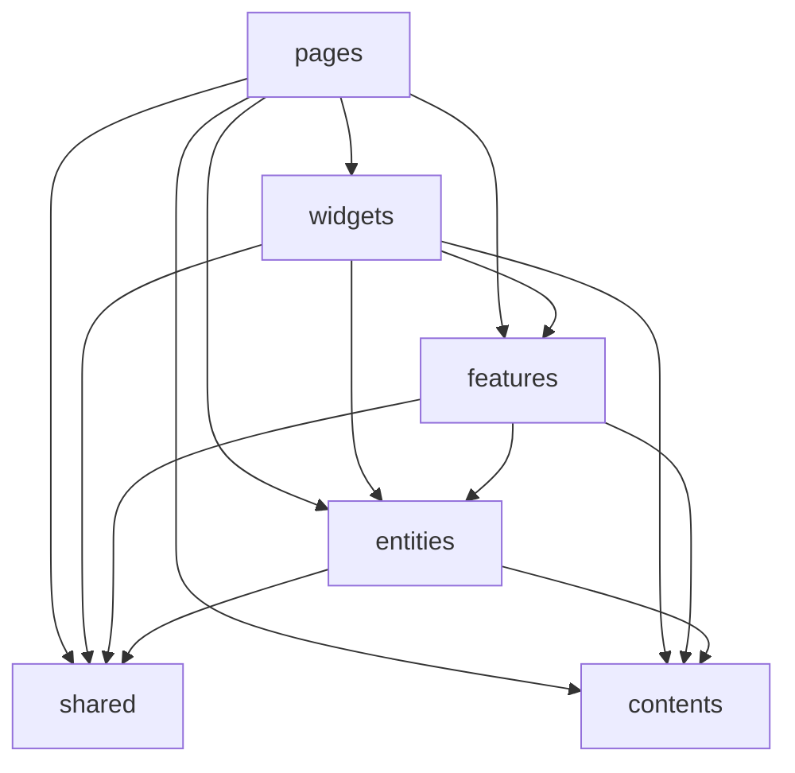

# Project structure

Feature-Sliced Design (FSD) with a few repo-specific choices. Official reference: https://feature-sliced.design/

## Layers

Dependencies flow **downward only** (never upward).



| Layer | Role |
|-------|------|
| `pages/` | Entry (Waku file-based routing), root layout, page metadata |
| `widgets/` | UI blocks on screen (concrete slice names, e.g. `creation-list`). Composes entities and features |
| `features/` | User actions or scenarios: UI, validation, and state for one intent, built on entities |
| `entities/` | The nouns: types, rules, paths, readers, **the noun's own UI**, and basic data operations (R and plain CUD) that do not know why they are called |
| `shared/` | Domain-agnostic infrastructure (utilities, UI kit, MDX infrastructure) |
| `contents/` | External data boundary, DTOs, transforms (like official `shared/api`, but a separate layer) |

### Which layer? One question

Does the module know **why** an operation happens (a use case)?

| Answer | Layer |
|--------|-------|
| No, and it is domain-agnostic | `shared/` |
| No, it belongs to a noun (type, rule, path, reader, the noun's UI, plain CUD) | `entities/<noun>` |
| Yes, it carries a user intent | `features/` |
| It arranges blocks on a screen | `widgets/` |

Examples:

- A creation's card (`CreationCard`), the writing reader, and the OG image path of a creation → `entities/<noun>` (UI goes in `entities/<noun>/ui/`)
- "Filter writings by type" carries a use case → `features/`
- MDX serializer, resolver, mermaid, twitter → `shared/mdx` (no domain knowledge)

### entities

`entities/<noun>/` holds everything that is the noun's own, including UI. Layout follows "Inside a slice" below.

### features

- A feature is a user action or scenario, not a bag of reusable UI.
- **Create a feature slice only when the same action is needed in a second widget.** Until then it stays in its widget. For example, how `getRelatedCreations` and `findRelatedWritingHeads` score and limit related items is a policy for one widget, so it stays in that widget.
- **No `features/` slice exists today.** The first candidate is `WritingTab` / `useGetWritingListType` in `widgets/writing-list`, once a second widget needs it.
- Layout when one is created: `features/<domain>/` is organizational only (no `index.ts`); the public API lives in `<feature-name>/index.ts`, imported as `from ".../features/<domain>/<feature-name>"`.

## Inside a slice (widgets / entities / feature package)

| Segment | Purpose |
|---------|---------|
| `ui/` | Components and related hooks, packaged by feature |
| `model/` | Types, kinds, and pure rules (including paths) as flat files; no I/O and no `contents/` imports |
| `repository/` | Readers and plain data operations on `contents/` (named for the source, not HTTP, so not FSD `api`). Conversions from `contents/` material to entity values go in `repository/contents-resolver/` |
| `<purpose>/` | A segment named for what it holds (e.g. `mdx-plugins/`). There is no catch-all `helpers/` or `lib/`; add `lib/` only for a real generic utility |

Build-only Node code (e.g. the OG image generator) lives in `scripts/`, not in a slice. `shared/` is outside this segment convention.

Colocate related components and hooks under `ui/<feature-name>/`.

```
widgets/creation-list/
  ui/
    creation-list/
      creation-list.tsx
  index.ts          ← Public API

entities/creation/
  ui/
    creation-card/
      creation-card.tsx
  model/
  repository/
  index.ts          ← Public API
```

## Rules

### [Must] Upper layers depend on lower layers only

Keeps change impact predictable.

### [Must] Expose slices via Public API

External code imports only through the Public API, not internal paths.

Usually a single `index.ts`. For RSC (Waku), split entries when **server-only** and **client-only** exports must not mix.

| File | Purpose | Leading directive |
|------|---------|-------------------|
| `index.ts` | Usable from both client and server (types, isomorphic helpers) | none |
| `index.server.ts` | Server Components, readers in `repository`, etc. | none |
| `index.client.ts` | Client-only hooks | `"use client"` required |

**Import rules (callers)**

- Server → server-only API: `from ".../slice/index.server"`
- Client → client-only API: `from ".../slice/index.client"`
- Either → shared API: `from ".../slice"` (`index.ts`)

**When to split**

- `useEffect`, browser APIs, React hooks → `index.client.ts`
- Build/request-only serializers → `index.server.ts`
- Mixing these in `index.ts` can pull client boundaries into server imports

**Example (MDX)**

```
shared/mdx/
  index.ts           # resolveMDXContent, types
  index.server.ts    # serializeMDXContent, markupMermaid
  index.client.ts    # useMermaid, useTwitter ("use client")
  content-resolver/
  mermaid/
  twitter/
```

```ts
// Server (reader)
import { serializeMDXContent } from "../../../shared/mdx/index.server";

// Client (UI)
import { useMermaid } from "../../../shared/mdx/index.client";
import { resolveMDXContent } from "../../../shared/mdx";
```

`shared/` folders are not checked slices; the barrels here are a convention to keep the server/client split.

Add `index.client.ts` / `index.server.ts` only where needed—not on every slice.

### [Must] kebab-case for directories and files

### [Should] Do not put component bodies in `index.ts`

`index.ts` is re-export only.

### [Must] No business logic in `shared`

- `shared/` — domain-agnostic utilities only
- `contents/` — external boundaries, DTOs, transforms (may include business knowledge)

### [Should] Place by the use-case question

See "Which layer? One question". Readers and a noun's UI go in `entities`; user actions in `features` (only once a second widget needs them); screen blocks in `widgets`; avoid abstract domain slices like `widgets/creation/`.
