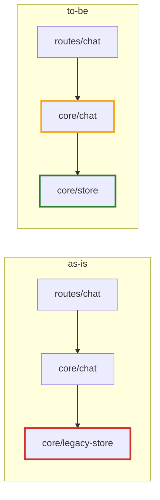

# Design

Agree on **where the current system changes and how**, so that implementation has no surprises. Requirements said what and why; design says how.

The user reviews the result. Do not start implementation until they approve.

## Flow

1. **Read the input.** Read `requirements.md` (see Output for where) and the as-is code it touches. If there is no agreed requirements document, say so and ask whether to write one first.
2. **Find the project's design rules.** See below. Do this before proposing anything.
3. **Show the diff from the as-is first.** Draw the module dependency graph before and after (mermaid, colored as in "Dependency graph before and after" below), and list what is added, changed, and removed. Use the same module and file names in the graph and the list, so the two can be compared at a glance. The user checks the overall shape here; details come later.
4. **Ask only where there is a real fork.** Data model, public interface, module boundaries, UI component split. For each fork give the options, a recommended default, and the reason, so the user can answer "OK". Do not ask about things the project's rules already settle.
5. **Trace the acceptance examples.** Map every acceptance example and every quality from the requirements (including what must **not** happen) to the module that satisfies it and the test that checks it. An example with no home means the design has a gap.
6. **Cut the implementation into slices.** Each slice is small enough to build and verify on its own. Note ordering constraints, such as which deploy must go before a destructive migration.
7. **Review and save.** Fix the draft from the user's feedback, record each decision with its reason, then save (see Output).

## Find the project's design rules

Projects differ in how they want things built. Do not assume; look.

- **Where:** the project's `CLAUDE.md`, its rules directory (such as `.claude/rules/`), and the list of available skills.
- **What for:** file and layer placement, how public interfaces and errors are shaped, where input is validated, test policy, database and migration handling, UI structure.
- **How:** from skill descriptions, pick only the ones relevant to this design and read those. Do not read everything.
- **If nothing applies:** follow the conventions of the existing code. If they do not decide the question, ask the user.
- **If a project rule conflicts with this skill's flow, the project wins.**

List what you applied in the document, and the areas where no rule was found.

## Document

Always include:

| Section | Content |
| --- | --- |
| Approach | The chosen design in a few lines |
| Diff from as-is | Added, changed, removed, plus the dependency graph before and after |
| Acceptance trace | Each acceptance example and quality → module and test or check that satisfy it |
| Decisions | Each decision with its reason and the alternatives rejected |
| Slices | Implementation order, with ordering constraints |
| Open questions | Only what is still undecided. Things to confirm while implementing go in a separate list, not here |
| Applied rules | Which project rules shaped the design; areas with none |

Add by condition:

| Condition | Artifact |
| --- | --- |
| It touches the database | Schema diff and migration order |
| It adds or changes a boundary | Interface of the new or changed boundary: inputs, outputs, errors, preconditions |
| A use case involves two or more modules or an external system | Sequence diagram per use case (below) |
| It has a UI | Component split, and which display rule from the requirements each one carries. Unless the change is only an obvious style tweak, show it on an Artifact (below) |

### Dependency graph before and after

Mark the diff on the graphs with node borders, so the change is visible without reading the list:

- **Before (as-is):** a **red** border on each module that will be removed.
- **After (to-be):** a **green** border on each added module, a **yellow** border on each changed module.
- Unchanged modules keep the default style. Edges that are added or removed follow the same colors where the renderer allows (`linkStyle`).

### UI on an Artifact

When the change touches the UI, beyond an obvious style tweak (a color, a spacing, a font size), build an Artifact that shows the screens after the change and labels each component of the split with the display rules it carries. Start from the requirements' UI sketch if there is one. Save its HTML next to the document (`sketch/`) and link the published Artifact URL from the document. If Artifacts are unavailable, say so and use a static HTML file or an image instead.

### Sequence diagram per use case

Draw one for each use case that crosses modules or talks to an external system; skip single-module ones. Use the use case ID from the requirements as the title.

- Show the failure paths too (`alt` / `opt`), and which module handles each common error from the requirements. Common errors are handled in one place, not per use case.
- Name each message after the step it performs. Implementation reuses these names (see `sdf-implement`).
- In the Acceptance trace, point each use case to its diagram.

## Output

Save to `docs/changes/<YYYYMMDD>-<feature>/design.md`, next to `requirements.md`. If the project's CLAUDE.md names another location for sdf documents, use that instead.

Start the file with the date and a status (`draft`, `agreed`, `implemented`). After implementation the code is the source of truth for the current behavior; this file stays as the record of what was agreed and why.

## Principles

- Stop at what the reviewer must agree on: boundaries, data, and decisions with their reasons. Leave pixel values, CSS, and component props to implementation.
- Drop sections that do not apply.
- If a state-heavy rule is hard to confirm by reading, say so and propose a stronger check (a formal spec tool or a model check) instead of silently trusting prose.
