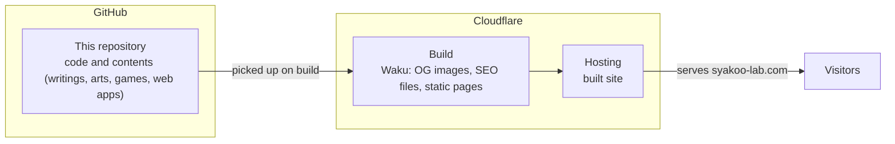

# Syakoo Lab

A personal website run by syakoo, built around the motto "interests that widen, deepen, and lead to discovery."

**Visit the site: https://syakoo-lab.com**

## What's on the site

- **Writings**: articles.
- **Creations**: arts, games, and web apps.
- **Profile**: a short introduction to the author on the home page.

## Architecture

Contents live in this GitHub repository. Cloudflare picks them up, builds the site with Waku, and serves the result to visitors.

The site is built with [Waku](https://waku.gg), React, Tailwind CSS, and TypeScript. The code layout is described in the [`project-structure` skill](.claude/skills/project-structure/SKILL.md).

## Author

[syakoo](https://github.com/syakoo)
