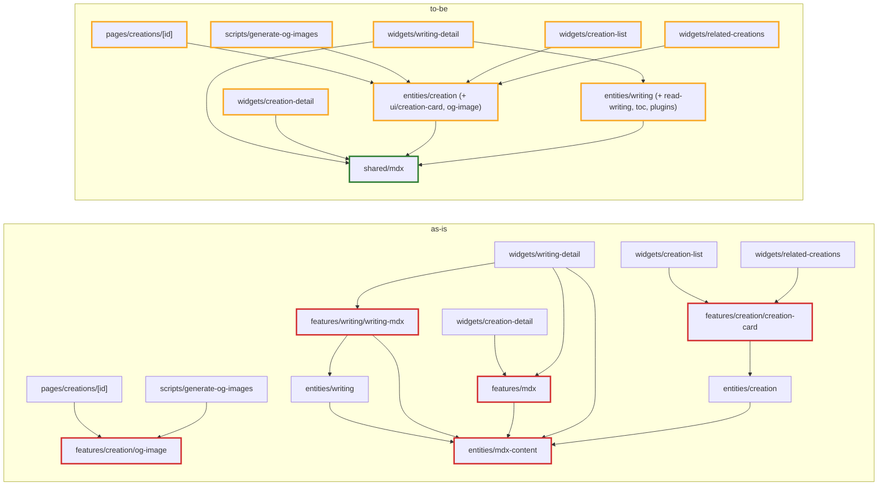

# Design: Re-define FSD layer roles

- Date: 2026-11-16
- Status: agreed
- Requirements: [requirements.md](./requirements.md) (agreed)
- Issue: #411

## Approach

A pure move-and-retarget refactor, plus a rewrite of the layer definitions in the `project-structure` skill. No module gets new logic; files move with `git mv`, and only their relative imports and the public-API barrels change.

- `entities/mdx-content` + `features/mdx` → one `shared/mdx` (keeps the existing server/client barrel split).
- `features/writing/writing-mdx` → `entities/writing` (reader beside `read-writing-heads`, TOC resolver, body plugins under `helpers/`).
- `features/creation/creation-card` → `entities/creation/ui/`.
- `features/creation/og-image` → `entities/creation` (path helper in `index.ts`, generator behind `index.server.ts`).
- `src/features/` ends up with no files. The layer stays in the skill and in `check-architecture.ts`.

## Diff from as-is

### Dependency graph

Only the moved modules and their direct callers are drawn. Edges into `shared` utilities and `contents` are omitted unless they change. The `page-title` move (six `pages/` files to one formatter, `entities` to `shared`) is a single edge change and is not drawn.

`pages`, `scripts` and the four widgets are yellow only because their import paths change.

### Moves

| From | To |
| --- | --- |
| `entities/mdx-content/{index.ts,index.server.ts}` | merged into `shared/mdx/{index.ts,index.server.ts}` |
| `entities/mdx-content/models/{mdx-content,serializer,types}.ts` | `shared/mdx/models/` |
| `entities/mdx-content/helpers/plugins/mermaid/mermaid-plugin.ts` | `shared/mdx/helpers/plugins/mermaid/mermaid-plugin.ts` |
| `features/mdx/{index.ts,index.client.ts}` | merged into `shared/mdx/{index.ts,index.client.ts}` |
| `features/mdx/content-resolver/**` | `shared/mdx/content-resolver/**` |
| `features/mdx/mermaid/**`, `features/mdx/twitter/**` | `shared/mdx/mermaid/**`, `shared/mdx/twitter/**` |
| `features/writing/writing-mdx/models/read-writing.ts` | `entities/writing/models/writing-reader/read-writing.ts` |
| `features/writing/writing-mdx/models/toc-resolver.ts` (+ `.test.ts`) | `entities/writing/models/writing-toc/toc-resolver.ts` (+ test) |
| `features/writing/writing-mdx/helpers/{plugins,image-plugin,markup-link-card-plugin,markup-section-title-plugin,heading-anchor-resolver}.ts` | `entities/writing/helpers/mdx-plugins/` |
| `features/creation/creation-card/ui/creation-card/**` | `entities/creation/ui/creation-card/**` |
| `features/creation/og-image/helpers/creation-og-image-path.ts` | `entities/creation/helpers/og-image/creation-og-image-path.ts` |
| `features/creation/og-image/{generate-creation-og-images,read-creation-thumbnail-paths}.ts` | `entities/creation/models/og-image/` |
| `entities/page-title/helpers/formatter.ts` | `shared/page-meta/format-page-title.ts` (the `entities/page-title` slice and its `index.ts` are deleted) |

### Public API changes

| Slice | Barrel | Adds |
| --- | --- | --- |
| `shared/mdx` | `index.ts` | `SerializedMDXContent`, `MDXCustomTextPlugin` (types), `resolveMDXContent` and its types |
| | `index.server.ts` | `serializeMDXContent`, `markupMermaid`, `MDXCustomTextPlugin` (type) |
| | `index.client.ts` | `useMermaid`, `useTwitter` |
| `entities/writing` | `index.ts` | `resolveWritingToc` |
| | `index.server.ts` | `readWritingById` |
| `entities/creation` | `index.ts` | `CreationCard`, `CreationCardProps`, `creationOgImagePath` |
| | `index.server.ts` | `generateCreationOgImages` |

Names are unchanged; only the module they come from changes. The merged `shared/mdx/index.ts` exports `MDXCustomTextPlugin` once (today it is re-exported by two barrels).

### Importers retargeted

- `src/pages/creations/[id].tsx`, `scripts/generate-og-images.ts`
- `src/pages/{privacy-policy,terms}.tsx`, `src/pages/writings/{index,[id]}.tsx`, `src/pages/creations/index.tsx` (`formatPageTitle` now comes from `shared/page-meta/format-page-title`; `shared/page-meta` has no barrel, so this is a direct file import, like `PageMeta`)
- `src/widgets/writing-detail/ui/writing-detail/{writing-detail.tsx,writing-detail.stories.tsx,writing-mdx-content.tsx}`
- `src/widgets/creation-detail/ui/creation-detail/creation-detail.tsx`
- `src/widgets/creation-list/ui/creation-list/creation-list.tsx`, `src/widgets/related-creations/ui/related-creations/related-creations.tsx`
- `src/entities/{creation/models/creation.ts,creation/models/creation-reader/read-creation.ts,writing/models/writing.ts}` (the `mdx-content` type imports)
- `.storybook/preview.ts` (`sb.mock` path of `read-writing.ts`)

### Docs

- `.claude/skills/project-structure/SKILL.md`: layer table, "widgets vs features", features layout, the MDX example, and the last rule. Rewritten for the use-case question. The `features` section gives a counter-example: a policy for one widget (for example how `getRelatedCreations` and `findRelatedWritingHeads` score and limit related items) stays in that widget until a second widget needs it.
- `.claude/rules/enforcement-inventory.md`: the two rows (`entities/` has no UI; `features/<domain>/` organizational layout), labels and link only.

### Not changed

`scripts/check-architecture.ts` (see Decision 5). `WritingTab` / `useGetWritingListType`. `contents/`.

## Requirements deviation to confirm

**Acceptance example 11 ("no baseline changes") cannot hold literally.** Stories have no explicit `title`, so the story ID comes from the file path. Moving the creation-card stories changes their IDs, and the VRT baselines are keyed by story ID:

| Baseline today | After the move |
| --- | --- |
| `__snapshots__/vrt/features-creation-creation-card-ui-creation-card--{illust,game,web-app}.png` | `__snapshots__/vrt/entities-creation-ui-creation-card--{illust,game,web-app}.png` |

The pixels must not change. The three PNGs are **renamed with `git mv`** (same bytes), not re-captured. The check becomes: the renamed files are byte-identical to `main`'s, and `storybook:test` passes against them. No other story moves, so no other baseline is touched. Proposed wording for example 11: "VRT passes with no re-captured baseline; the three creation-card PNGs are renamed to the new story IDs, byte-identical."

## Acceptance trace

| # | Example | Satisfied by | Check |
| --- | --- | --- | --- |
| 1 | Noun UI → `entities/<noun>/ui` | Slice 6: skill layer table and "entities" section | Read the skill |
| 2 | Reader / plain CUD → `entities`; use-case operation → `features` | Slice 6: skill rule of thumb, with the "filter writings by type" example | Read the skill |
| 3 | `features` states the second-widget condition and "no slice yet" | Slice 6: skill `features` section | Read the skill |
| 4 | Inventory rows updated, link only | Slice 6: `enforcement-inventory.md` | Read the diff; no rule text copied |
| 5 | `CreationCard` from `entities/creation`; two widgets import it there | Slice 3: `entities/creation/index.ts`; `creation-list`, `related-creations` | `pnpm type-check`; grep the two widgets |
| 6 | Writing reader, TOC, plugins in `entities/writing`; server exports behind `index.server.ts` | Slice 2: `entities/writing/{index.ts,index.server.ts}`; `writing-detail` | `pnpm type-check`; `toc-resolver.test.ts` still passes from its new path |
| 7 | MDX serializer, resolver, mermaid, twitter under `shared/`; none left in `entities/` or `features/` | Slice 1: `shared/mdx` | `entities/mdx-content` and `features/mdx` no longer exist |
| 8 | `creationOgImagePath` and generator in `entities/creation`; page and script import from there | Slice 4 | `pnpm type-check`; `pnpm build:og-images` runs |
| 9 | `src/features/` has no slice; `WritingTab` / `useGetWritingListType` stay | Slices 1–4 empty the layer; widget untouched | `git ls-files src/features` is empty; widget diff has only import-path changes elsewhere |
| 9a | `formatPageTitle` lives in `shared/page-meta`; `entities/page-title` is gone | Slice 5 | `pnpm type-check`; `entities/page-title` no longer exists; the six pages import the new path |
| 10 | lint, type-check, test pass | Every slice | The three commands before each slice commit |
| 11 | No VRT baseline changes | Slice 3 (see deviation) | Storybook VRT; renamed PNGs byte-identical to `main` |
| 12 | OG images byte-identical | Slice 4 | Generate on `main` and on the branch, compare `public/og/creations/*.png` by sha256 |
| 13 | Built pages unchanged | Final verification | Build on `main` and on the branch; compare the prerendered HTML |
| 14 | No shim or copy at an old path | Slices 1–4 use `git mv` and retarget every importer | `tsc` fails on a stale path; grep for each old path finds nothing |
| 15 | Layer-direction invariants | Existing `check-architecture.ts`: `shared` has the lowest layer rank, so it cannot import any other layer; `entities` cannot import `features`/`widgets` | `pnpm lint` |
| E1 | Checks fail after a move | One commit per slice, only when all three pass | `sdf` rule |
| E2 | Rendering differs | Never update a baseline to hide it | Examples 11–13 |

No use case crosses modules at runtime (the change is placement only), so there are no sequence diagrams. There is no UI change, so no Artifact sketch.

## Decisions

1. **MDX infrastructure becomes one `shared/mdx`, keeping its barrels.** Server and client exports must not share a barrel (project-structure, RSC split), so `index.ts` / `index.server.ts` / `index.client.ts` stay. Rejected: flatten into deep paths like the other `shared/` folders. That changes every import and loses the split for no gain; `shared` is not a checked slice, so the barrels are a convention, not a requirement.
2. **Internal layout inside each target slice mirrors what is there.** `entities/*` already use `ui/`, `models/<area>/`, `helpers/<area>/`. Reader beside `read-writing-heads`, helpers under `helpers/mdx-plugins/`, generator under `models/og-image/`. Rejected: keep the old folder names (`writing-mdx/`, `og-image/`) as sub-slices, which would put a slice-in-a-slice under the depth-2 slice rule of the check.
3. **Moved files import their own slice directly, not through its barrel.** For example `creation-card.tsx` imports `../../models/creation` rather than `entities/creation`; the stories import `../../models/creation.mocks`. This avoids a barrel importing a file that imports the barrel.
4. **Rename the three VRT baselines; do not re-capture.** The story IDs follow the path. Re-capturing on the agent's host would risk sub-pixel diffs (the threshold is 0 pixels); renaming keeps the proof that nothing changed. Rejected: an explicit story `title` to keep the old ID, which would hide the new location and break the auto-title convention.
5. **`check-architecture.ts` is not changed.** The open question from the requirements is settled by reading the script: the layer-direction table and `getSliceRoot` only act on files that exist, so an empty `features/` is not an error. The new files sit under `entities/<slice>/{ui,models,helpers}`, which the existing public-API check already handles (`ui` is an internal segment, so callers must use the barrel). `shared/mdx` is not a checked slice. Rejected: delete the `features` branch of `getSliceRoot`, since it would be re-added with the first feature slice.
6. **Docs are updated last (Slice 6).** One PR, so order does not matter for the reader, and writing the skill after the moves lets it quote the real paths. Rejected: update the skill first, which would describe a layout the code does not have yet.
7. **Verification of examples 12 and 13 is by comparison with `main`**, not by new tests. The change adds no behavior, so there is nothing for a new unit test to assert; the existing `toc-resolver.test.ts` moves with its code.

## Slices

Each slice is one commit that passes `pnpm lint`, `pnpm type-check`, `pnpm test`. Subjects end with `(Slice N)`.

| Slice | Content | Constraint |
| --- | --- | --- |
| 1 | `entities/mdx-content` + `features/mdx` → `shared/mdx`; retarget `features/writing/writing-mdx`, `entities/{creation,writing}` type imports, `writing-detail`, `creation-detail` | First: slices 2–4 import `shared/mdx` |
| 2 | `features/writing/writing-mdx` → `entities/writing`; retarget `writing-detail` (+ stories); update `.storybook/preview.ts` mock path | After 1. Run Storybook VRT (writing-detail stories render through the mocked reader) |
| 3 | `features/creation/creation-card` → `entities/creation/ui`; retarget `creation-list`, `related-creations`; `git mv` the three baselines | Independent of 1–2 |
| 4 | `features/creation/og-image` → `entities/creation`; retarget `pages/creations/[id]` and `scripts/generate-og-images.ts` | After 3 (same slice barrels). Compare OG output with `main` |
| 5 | `entities/page-title` → `shared/page-meta/format-page-title.ts`; retarget the six pages | Independent of 1–4 |
| 6 | Rewrite `project-structure` skill (including the one-widget-policy example); update the two inventory rows | Last |

After slice 6: run the full VRT and compare a build with `main` (example 13), then the fresh-context review.

## Open questions

None.

## To confirm while implementing

- Exact file names under the new `entities/*` folders (Decision 2 gives the proposed layout; implementation may adjust if a name collides).
- Whether the prerendered HTML is byte-identical between builds, or needs a normalization for hashed asset names (example 13).
- Whether any Storybook story outside creation-card changes ID. The scan found only the three above; re-check after slice 2.

## Applied rules

- `project-structure` skill: layer direction, slice public API and RSC barrel split, kebab-case, `index.ts` re-exports only, no business logic in `shared`.
- `coding-guide` skill: Storybook VRT (baseline handling), colocated tests, deep-module principle (barrels stay small).
- `sdf` rule: document location and language, one commit per slice with `(Slice N)`, checks before each slice, no `--no-verify`.
- `single-source-of-truth` rule: the inventory rows stay links; rule text lives only in the skill.
- No project rule found for: moving Storybook baselines (handled by Decision 4), build-output comparison (handled by examples 12–13).
