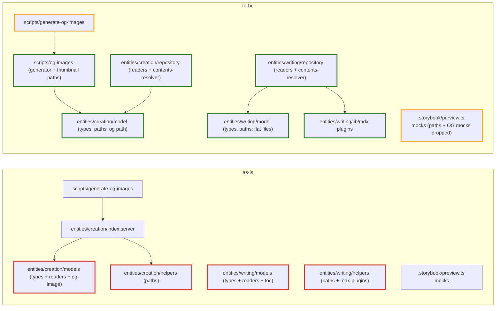

# Design: Align entity segments with FSD vocabulary

- Date: 2026-11-17
- Status: implemented
- Requirements: none (waived by the owner; the problem and idea are in the issue)
- Issue: #413

## Approach

A move-and-retarget refactor, like #412. No module gets new logic.

- `models/` → `model/`: types, kinds, and pure rules only, as flat files (including paths and the OG image path, which are pure string derivations). `model/` does not import `contents/`.
- New `repository/`: readers and plain data operations (`read-*`). Conversions from `contents/` material (frontMatter, Markdown text) to entity values live in `repository/contents-resolver/` (`to-creation-summary`, `head-resolver`, `toc-resolver`). Because they know the source's shape, they belong to the data-access side, not `model/`. Named `repository` instead of FSD `api` because the data comes from `contents/`, not over HTTP.
- `helpers/` is removed. Paths move to `model/`; `entities/writing/helpers/mdx-plugins` becomes `entities/writing/lib/mdx-plugins/` (FSD `lib`: tools that do not know the noun, I/O allowed).
- The OG generator (`generate-creation-og-images`, `read-creation-thumbnail-paths`) leaves `entities/` and moves to `scripts/og-images/`. It is build-only Node code, so no slice barrel should carry it. `scripts/generate-og-images.ts` imports it directly; the app and Storybook never load it.
- `project-structure` skill: define each segment; `check-architecture.ts`: recognize the new segment names.

## Diff from as-is

### File moves (`git mv`)

| From | To |
|------|----|
| `entities/creation/models/creation.ts`, `creation.mocks.ts`, `creation-type/creation-type.ts` | `entities/creation/model/` (flat) |
| `entities/creation/helpers/paths/creation-paths.ts`, `helpers/og-image/creation-og-image-path.ts` | `entities/creation/model/` (flat) |
| `entities/creation/models/creation-reader/read-creation.ts` | `entities/creation/repository/` |
| `entities/creation/models/creation-reader/to-creation-summary.ts` | `entities/creation/repository/contents-resolver/` |
| `entities/creation/models/og-image/*` (generator, thumbnail paths); the `__mocks__` are deleted | `scripts/og-images/` |
| `entities/writing/models/{writing.ts,writing.mocks.ts}`, `writing-type/writing-type.ts`, `helpers/paths/writing-paths.ts` | `entities/writing/model/` (flat) |
| `entities/writing/models/writing-reader/read-*.ts` | `entities/writing/repository/` |
| `entities/writing/models/writing-reader/head-resolver.ts`, `writing-toc/toc-resolver.ts` (+ test) | `entities/writing/repository/contents-resolver/` |
| `entities/writing/helpers/mdx-plugins/` | `entities/writing/lib/mdx-plugins/` |
| `shared/mdx/{models,helpers}` and `shared/mdx/*/helpers` | Out of scope (left as is; see Decision 6) |

Changed: `entities/*/index*.ts` re-export paths, `.storybook/preview.ts` mock paths (the two OG mocks and `read-creation-thumbnail-paths` mock go away), `scripts/check-architecture.ts` (`isInternalSegment`: `ui`, `model`, `repository`, `lib`; files under a retired `models/` / `helpers/` segment are violations), `project-structure` skill (segment table), `package.json` `build:og-images` only if the path changes.

## Acceptance trace

No requirements document, so the checks come from the issue's wants.

| Want | Satisfied by | Check |
|------|--------------|-------|
| `models/` → `model/`, pure only | moves above | `pnpm lint` (architecture check fails on `models/` imports) |
| Readers in `repository/` | moves above | architecture check; `pnpm type-check` |
| `helpers/` gone | moves above | architecture check rejects `helpers` |
| OG generator off the reader barrel | `scripts/og-images/` | `pnpm build:og-images` still produces images; `index.server.ts` has no `sharp`/`glob` |
| Storybook needs no OG/Node workaround | mocks dropped | `pnpm test` (Storybook tests), Storybook build |
| Skill says what goes where | `project-structure` rewrite | review |
| No behavior change | pure moves | `pnpm test`, VRT shows no diff |

## Decisions

1. **`repository/` over `api/`.** `api` suggests HTTP; the entity layer's role says readers and plain data operations. Rejected: `api` (fidelity to FSD, but misleading here).
2. **OG generator in `scripts/og-images/`.** It is only run at build time, so it is not a noun's reusable capability; keeping it in a slice always risks being barrel-loaded. Rejected: an `og-image/` segment with its own entry such as `index.og-image.ts` (still a Node-only module inside a slice, needs a new barrel rule and check).
3. **Paths and OG path live in `model/`.** They are pure conversions of the noun's id. Rejected: `lib/` (name says nothing about purpose).
4. **`lib/<purpose>/` instead of `helpers/`.** `lib/` holds tools that do not know the noun (the `mdx-plugins` use `sharp` and `fetch`, so they are not `model/`; they are not data reading, so not `repository/`). Only purpose-named folders go in it, which avoids a catch-all. Rejected: a bare `mdx-plugins/` segment (mixes role names with content names) and moving them to `shared/mdx` (out of scope, Decision 6; a candidate for a later PR).
5. **Mocks stay in `model/`** (`*.mocks.ts`), unchanged.
6. **`shared/mdx` is out of scope; this change covers `entities/writing` and `entities/creation` only.** `shared/` is not a slice layer and `check-architecture.ts` does not check it; entities use `shared/mdx` only through its barrels, so its internal segment names do not affect them. The `project-structure` skill states that `shared/` is outside the segment convention. Cost: `shared/mdx` keeps `models/` and `helpers/` for now; a later PR can rename them. Rejected: renaming in this change (widens the diff without a check to back it).
7. **Contents-to-entity conversions live in `repository/contents-resolver/`, and `model/` is flat.** `toc-resolver` (Markdown text) and `head-resolver` / `to-creation-summary` (frontMatter) all take `contents/` material, so they know the source's shape; keeping them out of `model/` leaves it free of `contents/` imports. `model/` subfolders held one file each, so they are flattened. Their `index.ts` exports (`resolveWritingHead`, `resolveWritingToc`) were unused and are dropped. Rejected: `model/resolvers/` (puts `contents/` types in `model/`).

## Slices

1. Entities: rename `models`→`model`, add `repository/`, move paths, retarget imports and barrels (creation and writing together, since both share the skill/check change).
2. Move OG generator to `scripts/og-images/`; drop the Storybook mocks it needed; verify `build:og-images`.
3. Move `mdx-plugins/` to `lib/mdx-plugins/`; remove `helpers/`; flatten `model/`; move contents resolvers to `repository/contents-resolver/`.
4. Update `check-architecture.ts` and the `project-structure` skill (state that `shared/` is outside the segment convention; `enforcement-inventory` only if a row changes).

## Open questions

None.

## Applied rules

`sdf`, `ai-workflow`, `single-source-of-truth` rules; `project-structure` and `coding-guide` skills; `scripts/check-architecture.ts`. No rule found for naming segments beyond the skill's table (rewritten here).

## Changes during implementation

- 2026-11-17: Decision 7 added after review. Contents resolvers moved to `repository/contents-resolver/` and `model/` flattened (owner's call). The OG `__mocks__` were deleted instead of moved.
- 2026-11-17: Decision 4 changed after review: `mdx-plugins` goes under `lib/` (owner's call), with a `model` / `repository` / `lib` test added to the skill.
