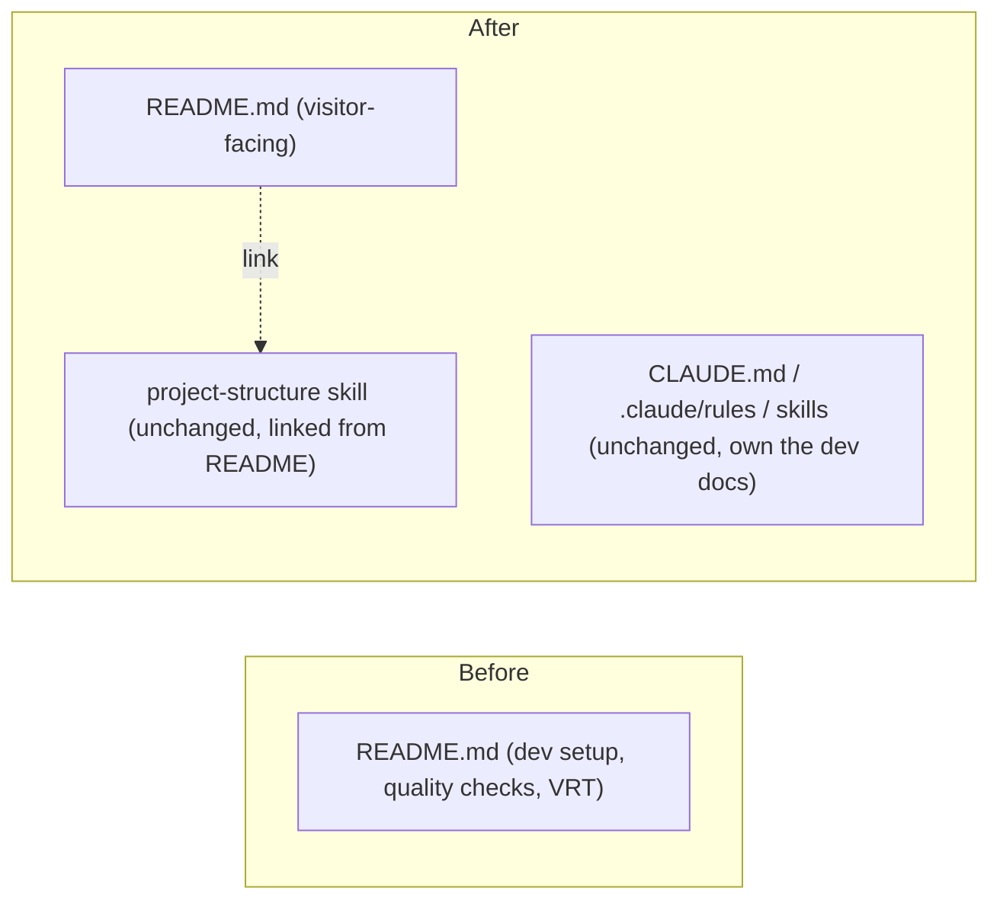
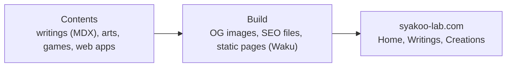

# README for visitors: design

- Date: 2026-11-02
- Status: implemented
- Requirements: [requirements.md](./requirements.md)

## Approach

Replace the body of `README.md` with a visitor-facing English document: summary and link, what is on the site, an architecture overview as a Mermaid diagram, and the author. No code, config, or other docs change.

## Diff from as-is

Before and after (documents only; no code modules are touched):

| Change | Item |
| --- | --- |
| Changed | `README.md`: rewritten in English for visitors |
| Removed | README sections "Development", "Quality checks", "Visual Regression Testing (VRT)" |
| Added | README "Architecture" section with a Mermaid diagram |
| Unchanged | `CLAUDE.md`, `.claude/rules/*`, skills, all source code |

Nothing else references the README's removed sections (checked by search). The VRT rules remain in the `coding-guide` skill; the quality-check commands remain in `package.json` scripts and `enforcement-inventory`. The `pnpm install` / `pnpm dev` lines have no other home; their removal is accepted by the requirements.

## README structure

| Section | Content |
| --- | --- |
| Title and summary | `# Syakoo Lab`, one-line description, motto, link to https://syakoo-lab.com |
| What's on the site | Writings (articles), Creations (arts, games, web apps), and a short author profile on the home page. One link only: the site itself |
| Architecture | Diagram below, plus one line on the stack (Waku, React, Tailwind CSS, TypeScript) and a link to the `project-structure` skill for the code layout rules |
| Author | syakoo, link to https://github.com/syakoo |

Architecture diagram (visitor-level, not the FSD rules):

## Acceptance trace

| # | Example | Satisfied by | Check |
| --- | --- | --- | --- |
| 1 | First screen states what the site is and links to the site | "Title and summary" at the top of `README.md` | Read the rendered README on the PR branch |
| 2 | Lists what the site offers, matching current pages | "What's on the site" | Compare with `src/pages/` (home, writings, creations) |
| 3 | Diagram renders on GitHub, no text fallback | Mermaid block in "Architecture" | View the rendered README on GitHub |
| 4 | No setup, quality-check, or VRT instructions | Sections removed | Search the README for `pnpm`, `VRT`, `lint` |
| 5 | English | Whole file | Read |
| 6 | Layer rules not restated; owner is linked | One link to the `project-structure` skill, no layer-direction text | Read |
| 7 | Staleness accepted | No automated check | None (accepted) |

These are checked by reading, not by tests: the change has no code, so there are no Vitest tests, Storybook stories, or VRT baselines to update.

## Decisions

- **Mermaid, not an image.** GitHub renders it, it is diffable, and it needs no asset upkeep. Rejected: an exported PNG/SVG (stale-prone, binary diffs).
- **Diagram at three boxes.** Visitors need the flow, not the layers. The layered layout is owned by `project-structure`; the README links to it (`single-source-of-truth`). Rejected: drawing FSD layers in the README (would copy the owner's rule).
- **"About me" is a profile section on the home page**, not a separate page, so the README lists it as "a short author profile on the home page" and adds no separate link. The requirements' wording "About me page" is read as this section. The owner chose to keep it in the list (the "Author" section also links to GitHub).
- **No new tests or checks**, since only prose changes.

## Slices

1. **Slice 1: Rewrite `README.md`** with the four sections above, then verify acceptance examples 1 to 6 by reading the rendered file. This is the only slice.

Checks before the slice commit: `pnpm lint`, `pnpm type-check`, `pnpm test` (expected to be unaffected). UI is not touched, so no Storybook VRT.

## Open questions

None.

## Applied rules

- `sdf` rule: document location, Draft PR, one commit per slice.
- `single-source-of-truth` rule: the README links to `project-structure` instead of copying it.
- `enforcement-inventory` rule: confirms no lint or architecture check is affected by a README change.
- No rule was found for README content or Mermaid use; existing code conventions do not apply to prose.

## Changes during implementation

None. The README section for the author profile is titled "Profile", as decided above.
