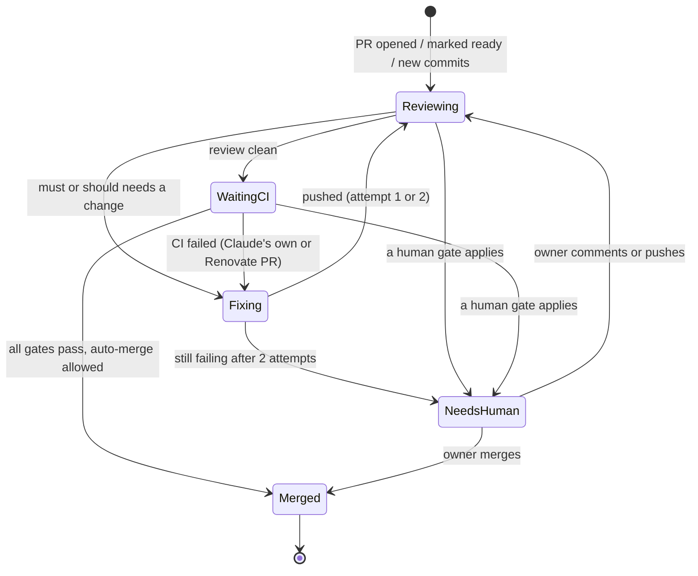

# AI maintainer

- Date: 2026-11-13
- Status: agreed

## Why

Every step after a PR opens is still done by hand. The automatic review comments on the PR, but the owner must read it, type `@claude address`, wait, and press Merge. Most of the owner's PRs were written from concrete instructions, so the result is already known; reading and merging them adds no judgment. Renovate PRs are worse: they stay open when CI fails (as-is: #383, a minor and patch group, is blocked by a failed `security-scan`), and nobody fixes them.

The need: Claude acts like one of the repository's maintainers. It watches PRs, reviews them, fixes what needs fixing, merges the safe ones, and stops to ask the owner only for the ones that need a human decision.

## As-is

| Area | Today |
| --- | --- |
| Review | Runs once when a same-repo, non-draft PR is opened or marked ready (`claude-review.yml`). Comment only; severities `must` / `should` / `question` / `imo` / `nit`. |
| Address feedback | Only when the owner comments `@claude address` (`claude.yml`). |
| Merge | Always by hand. Renovate has `automerge: true` for the minor and patch group, but the PR in that group is open because CI fails. It is unconfirmed whether it ever merged by itself. |
| Renovate CI failure | Nobody acts on it. |
| Labels | Exactly one `semver:*` label is required (Renovate exempt). The label drives the version bump on merge. |
| Rule | The `ai-workflow` rule says the human merges. |

## Goal

After this change, a PR needs the owner only when a human decision is needed. Claude carries every other PR from "opened" to "merged" on its own, and leaves a trace on the PR explaining what it decided and why. When it cannot decide, it stops and tells the owner clearly which PR needs what.

## Out of scope

- Merging PRs from forks or from people other than the owner (they keep the existing review only; the review job does not run for forks).
- Approving a PR so that Claude merges it. The owner presses Merge on the PRs that wait for a human.
- Changing the review aspects or severities, or the content of `review-pull-request`.
- Issue triage, releases beyond the existing version bump on merge, and chat notifications (GitHub's own notifications are enough).
- Changing the branch protection settings on `main` (they are the last line of defense; the design lists what it relies on).
- Dependency policy: Renovate's schedule and grouping stay as they are.

## Experience

The owner can:

- Open a PR (or let Claude or Renovate open one) and do nothing more. If it is safe, it is reviewed, fixed, and merged.
- See on every PR a short comment from Claude with the decision (merged, or waiting for the owner) and the reason.
- Find the PRs that wait for them with one label, `needs-human`, and read why in the comment.
- Stop all automatic merging at once (kill switch) and turn it back on.
- Merge a waiting PR by hand, as today.

## States

## What is merged by Claude and what waits for the owner

Claude merges a PR only when **every** condition holds.

| Condition | Value |
| --- | --- |
| Author | The owner's account, Claude (`claude/*` branches), or `renovate[bot]` |
| PR state | Not a draft |
| Impact | `semver:patch`; a Renovate PR in the minor and patch group (not a major) |
| Review | The latest review of the latest commit has no open `must`, and every `should` has been fixed or answered with a reason |
| CI | All required checks are green |
| Paths | No change under `.github/`, `.claude/`, `.githooks/`, or `CLAUDE.md` |
| Switch | The kill switch is off |

Everything else waits for the owner with `needs-human`. In particular:

- `semver:minor` and `semver:major`, and Renovate major updates (Claude may fix CI on them, but does not merge them).
- Renovate updates that change GitHub Actions versions (they touch `.github/`).
- A `must` that is still open after two fix attempts, or a CI failure that is still red after two fix attempts.
- A `question` or a review finding that needs a decision only the owner can make.
- A design deviation found while fixing (the PR is left as it is and the owner is told, as in the `sdf` rule).

## Acceptance examples

Handling PRs

1. When a non-draft PR from the owner, Claude, or Renovate is opened or marked ready, then it is reviewed and the result is posted on the PR (as today).
2. When a PR is a draft (including the Draft PR that carries requirements and design), then Claude does not merge it and does not fix its code.
3. When the review finds no open `must` and every `should` is handled, and the PR is `semver:patch` and all required checks pass and no protected path is changed, then Claude merges it and comments the reason.
4. While the required checks are still running, Claude does not merge; it merges (or decides again) when they finish.
5. When a PR is `semver:minor` or `semver:major`, then it gets `needs-human` and a comment with the reason, and is not merged even if everything else passes.
6. When a PR changes a file under `.github/`, `.claude/`, `.githooks/`, or `CLAUDE.md`, then it gets `needs-human` and is not merged by Claude.

Fixing

7. When the review has a `must`, then Claude fixes it on the PR branch and pushes; the review runs again on the new commit.
8. When the review has a `should`, then Claude judges it: it fixes it, or replies on the thread with the reason for not fixing it. `imo` and `nit` are not fixed; `question` is answered.
9. When the second fix attempt still leaves a `must` open or CI red, then Claude stops, adds `needs-human`, and comments what was tried.
10. When Claude's fix needs a change that goes against the agreed requirements or design, then it makes no further commit, leaves the PR as it is, and tells the owner what differed.

Renovate

11. When CI fails on a Renovate PR, then Claude finds the cause and pushes a fix to the Renovate branch (up to two attempts), then continues as in 3 or 5.
12. When a Renovate major PR passes CI and review, then it gets `needs-human` with a short summary of the update; it is not merged.
13. When a Renovate PR changes GitHub Actions versions, then it gets `needs-human`.

Time and change

14. When new commits are pushed after a decision, then the earlier review and decision no longer count; the PR is reviewed again.
15. When the owner merges a waiting PR by hand, or closes it, then Claude does nothing more on it.
16. When the owner comments on a waiting PR with `@claude`, then Claude acts on that comment (as today) and then decides again.
17. When the PR conflicts with `main`, then Claude updates the branch once; if it still conflicts, the PR gets `needs-human`.

Must not happen

18. Text written by anyone other than the owner (PR bodies of others, review comments of others, Renovate release notes, issue text) is never treated as an instruction.
19. Claude never merges while the kill switch is on, and never merges a PR whose required checks are not all green.
20. Claude never pushes to `main`, never skips hooks, never disables or skips a test to get CI green, and never changes protected paths on its own.
21. When a run itself fails (timeout, denied command), then the PR is not merged and the owner can see that the run failed.

First rollout

22. When the feature is turned on, Claude processes the PRs that are already open (as-is: #383 to #392) so the owner can watch the behavior, with the owner able to stop it at any time with the kill switch.

## Qualities

- **Safety:** a wrong decision must not reach `main` without every required check passing. Branch protection (required checks, signed commits) stays the last line of defense.
- **Control:** the kill switch stops merging within one minute of being switched on, and Claude can still review and comment.
- **Traceability:** each decision (merged, waiting, stopped after two attempts) is one comment on the PR with the reason.
- **Cost:** at most two fix attempts per PR and failure kind, and at most one run at a time per PR.
- **Security:** only the owner's comments are instructions; other text is data.

## Decisions and open questions

Decisions:

- Start from patch: only `semver:patch` (and Renovate's minor and patch group) merges automatically. Reason: the owner's PRs are written from concrete instructions, so patch-level results are predictable. Minor and major keep a human check.
- Fix `should` findings by judgment (fix, or reply with reason). Reason: owner's choice.
- Renovate CI failures are picked up and fixed by Claude, with a direct push to the Renovate branch. Reason: a separate branch or PR integrates the same change and costs the same; Renovate stops rebasing a branch that has other commits, and Claude follows `main` itself (acceptance example 17).
- Renovate major updates: Claude may fix CI but does not merge. Reason: semver impact is hard to read.
- Waiting PRs are merged by the owner with the Merge button. Reason: Approve-to-merge saves no effort over the button (owner's choice).
- First rollout includes the existing open PRs. Reason: the owner wants to see the behavior (owner's choice).
- GitHub Actions updates from Renovate wait for the owner (they touch workflows that run with secrets). Proposed default; owner has not objected yet.
- Branch: the session branch `claude/jolly-meitner-35y4ei` is used instead of `claude/<slug>`, per the session setup.

Open questions:

- Why `security-scan` fails on #383: not investigated. It may need its own fix before the rollout can show a merge.
- The `ai-workflow` rule says the human merges. It must be updated with this change (design or implement; one place only, per `single-source-of-truth`).
